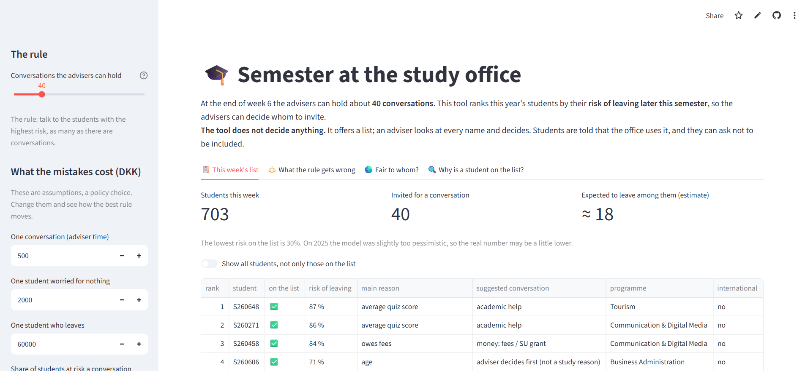

# Semester at the study office: who should advisers talk to?

A Streamlit app that helps a university study office decide which first-year students to invite
for a conversation at the end of week 6, before they drop out.

**[Open the live app →](https://study-officeapp-project.streamlit.app/)**



## The problem

Three advisers can hold about 40 conversations at the end of week 6. The app ranks this year's
students by their risk of leaving later in the semester, so the advisers can choose whom to
invite. **The tool doesn't decide anything:** it suggests a list, and an adviser reviews every
name.

## What the app does

| Tab | What it shows |
|---|---|
| **This week's list** | Students ranked by dropout risk, the main reason behind each risk and a suggested type of conversation (academic help, fees/SU grant, check-in) |
| **What the rule gets wrong** | Tested on the 2025 cohort: students reached in time, missed and worried for nothing (precision and recall), plus the net value in DKK of each number of conversations, using cost assumptions the user can change |
| **Fair to whom?** | The same rule compared for domestic and international students |
| **Why is a student on the list?** | The factors that raise or lower one student's risk |

## Model

- **Logistic regression** trained on the 2023–2024 cohorts and tested on 2025 (**AUC 0.81**).
- Inputs: study activity in weeks 1–6 (quiz scores, assignments handed in, logins) plus
  background such as fees owed, SU grant and admission grade.
- The model is stored as plain JSON (`model/`) and read by `portable_logit.py`, so the app needs
  no scikit-learn at runtime.

## What I took from it

- A ranking only becomes useful once it is tied to a capacity (40 conversations) and to costs.
  The best number of conversations depends on what a missed dropout is assumed to cost.
- A model can be accurate overall and still treat groups differently: international students
  who leave are reached less often, because logins mean something different for them.
- Students flagged mainly for things they can't change (age, programme) get a warning, so an
  adviser checks their study activity first.

## Run it

```bash
pip install -r requirements.txt
streamlit run app.py
```

## Data and credits

Synthetic students resampled from the UCI dataset
[Predict students' dropout and academic success](https://archive.ics.uci.edu/dataset/697/predict+students+dropout+and+academic+success)
(CC BY 4.0), provided through the AAU course repository.

 assignment for the MSc in Business Data Science, Aalborg University (2026)
